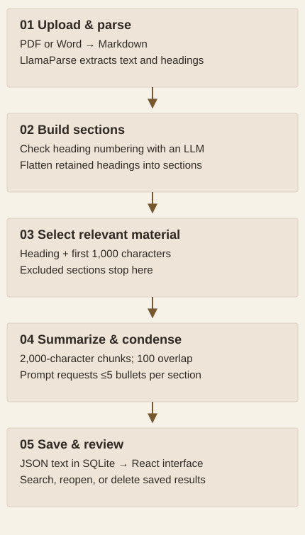

# Turning long solicitations into a section-by-section review

**Elias Brown · Parsing, AI summarization, React & integration · Team capstone, May 2025**

A request for information or proposal asks a business to explain how it could meet a client's needs. The relevant work can be scattered across a long document, mixed with administrative clauses and inconsistent headings. Our capstone for Acato explored a practical question: **how can a reviewer find the sections that matter to a software quality-assurance business and return to them later?**

We built an application that accepts PDF or Word documents, selects sections for relevance, produces concise summaries, and saves the results in a searchable interface. Its central design choice was to **select before summarizing**: focus the digest on potentially relevant work, while leaving the final assessment to a person.

## What the team delivered

The project connected document parsing, language-model prompts, a FastAPI backend, SQLite storage, and a React/Next.js interface. The final presentation shows the upload view, an in-progress request, a saved section summary, and a searchable results database. The source implements those main paths.

<strong>3</strong>document records in the recovered April 2025 snapshot

<strong>55</strong>stored section summaries in those records

<strong>≤5</strong>top-level bullets in each saved section summary

<strong>4</strong>team members across processing, interface, and backend

The snapshot is a small record of saved outputs, not the full project corpus or a labeled accuracy test. Counts were checked from preserved data for this reading edition; no new parsing or model calls were made.

The result demonstrates an end-to-end review workflow and compact stored outputs. The presentation also reports that the tool reduced manual review effort and produced useful summaries. Those are the team's qualitative observations; the available evidence does not quantify time saved or establish the completeness of the summaries.

## Follow a document through the system

The parser first turns the file into text with Markdown headings. The application checks section boundaries, selects material that appears relevant, and summarizes the selected sections. A saved digest can then be searched, reopened, or deleted.

<strong>How to read the diagram:</strong> follow the arrows downward. Selection is a gate: a section rejected there does not appear in the final digest.

<figure class="analysis-figure diagram-figure narrow-diagram">

<figcaption><strong>From document to saved digest.</strong> This diagram describes the implemented 2025 workflow. The five stages represent processing roles, not five model calls. Source: parser.py, summarization.py, main.py, and SolicitationDashboard.jsx at commit c8105f8.</figcaption>
</figure>

The relevance decision uses a section's heading and its first 1,000 characters, alongside a capability description. This bounds the text sent to that decision step. It also means a requirement appearing later in a long section may not influence whether the section is selected. That tradeoff is central to understanding the tool.

[Explore the saved evidence](docs/EVIDENCE.md) · [Read the processing methods](docs/METHODS.md)

## My contribution and the team's work

I worked with three teammates. My work covered document parsing, prompts and summarization, the frontend, and integration. My teammates handled backend and database development. The application was our shared deliverable.

| Area | My contribution |
|---|---|
| Document parsing | Developed the document-to-text workflow and instructions for extracting useful structure |
| Relevance and summarization | Developed prompts and the processing sequence for selecting and condensing sections |
| Frontend | Developed the upload, progress, results, and saved-summary interfaces |
| Integration | Connected document processing and the interface to the team's backend and persistence layer |

## Why the project focused on summaries

The presentation considers two broader approaches: retrieving prior material to draft responses, and fine-tuning a model to classify opportunities as a good fit, a poor fit, or a fit with partners. The team reported a limited response knowledge base and only 18 solicitations for the proposed classification approach.

The delivered application instead uses existing language models through prompts to select and summarize sections. It does not train a new language model, implement the presentation's retrieval diagrams, or demonstrate automatic proposal generation. The 18-document figure describes the alternative discussed in the slides; it is not the denominator for the saved-output audit.

## What this work makes possible

The application gives a reviewer a compact, reusable starting point for understanding an opportunity. Preserving section headings makes the output easier to navigate than an undifferentiated document summary, while persistence avoids treating every review as a one-time interaction.

The next evaluation should test whether important requirements survive selection and compression, then measure review time against a manual workflow. Source-page citations and a view of excluded sections would help a person verify the digest. Proposal generation, fit classification, folders, and bulk actions were future-work ideas in the presentation.

## About this reading edition

This report combines the public implementation at **c8105f8**, all ten slides of the team's **May 2, 2025** final presentation, and an April 2025 database snapshot preserved in Git history. The review covered slide text and visuals; no audio or transcript was available. Original code, stored data, and presentation files were preserved.

The later local demo includes scripted opportunities and generated reviewer decisions. It is identified separately on the evidence page and is not used to claim capstone accuracy or adoption. This November 2026 reading edition, aggregate audit, and explanatory figures were prepared with AI assistance.

[Original source repository](https://github.com/eliasbrown99/Capstone) · [Evidence, sources, and claim review](docs/EVIDENCE.md)
