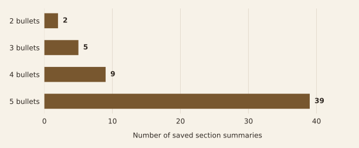
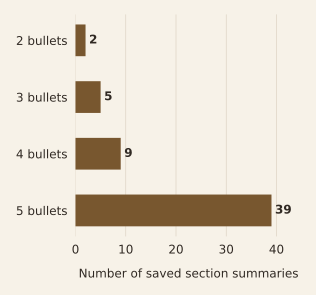

# What the saved evidence shows

**Evidence review · Original presentation, implementation, and preserved outputs**

The capstone produced an integrated review application and saved section summaries. The available records let us examine the shape of those outputs and check the presentation's description of the workflow. They do not establish how many important requirements the system missed or how much review time it saved.

## Compact summaries are visible in the stored output

An April 2025 database snapshot contains **3 document records with distinct filenames and 55 section summaries**. Its stored upload dates span April 21–24. All 55 summaries are nonempty and contain between two and five top-level bullets; 39 contain five.

This supports the project's goal of producing concise, structured output. A short summary can still omit a condition or misstate a requirement, so output length should not be interpreted as factual accuracy.

<p class="chart-guide"><strong>How to read the chart:</strong> each bar counts section summaries with the indicated number of top-level bullets. A section summary is one observation; the 55 summaries come from only three saved document records.</p>

<figure class="analysis-figure">


<figcaption><strong>Most saved summaries use the requested five-bullet format.</strong> Counts are descriptive of the recovered snapshot. One summary contains three top-level bullets and three nested bullets; counting every bullet line would give six for that summary.</figcaption>
</figure>

<details class="method-note">
<summary>See exact values and counting definitions</summary>

| Top-level bullets | Section summaries |
|---|---:|
| 2 | 2 |
| 3 | 5 |
| 4 | 9 |
| 5 | 39 |
| **Total** | **55** |

One observation is one object in a stored document's summary list. A bullet line starts with a dash, asterisk, bullet symbol, or numbered-list marker. Top-level bullets have the smallest indentation within that summary. The audit also counts nested bullets separately, checks for empty summaries, and verifies that the distribution totals 55. Distinct filenames are not a content-based deduplication rule.

</details>

The snapshot is preserved at commit `aa91149b093b438564d85b017198a2a2686ad2fe`, before the database was removed from the tracked tree. The summarization source at that point matches the reviewed main-branch version. That does not establish which exact code version produced every saved row. The database is not a complete run log and does not record model versions, input hashes, excluded sections, or evaluation labels.

[Download the aggregate audit](../analysis/derived/saved-output-audit.json) · [Inspect the audit script](../scripts/audit_saved_outputs.py) · [Inspect the figure script](../scripts/generate_figures.py)

## Keep the presentation's findings at their supported scope

| Original finding or figure | Reading-edition treatment | Reason |
|---|---|---|
| Section-based summaries and saved-results UI, slides 5–7 | **Retain** the delivered workflow; redraw its connections | Code, saved rows, and slide screenshots support implementation |
| Five-bullet summaries, slides 3, 5, and 7 | **Recompute and specify** top-level bullets in saved output | All 55 have at most five top-level bullets; one has nested details; the code relies on prompts rather than a hard validator |
| Reduced manual effort and useful summaries, slide 8 | **Retain as qualitative team observations** | No timed comparison or independently labeled quality test was found in the reviewed evidence |
| Dynamic extraction across formats, slide 7 | **Narrow to implemented handling** | PDF/Word inputs are accepted, but heading refinement favors numbered and Roman-numeral titles |
| RAG and fine-tuning diagrams, slide 4 | **Label as alternatives considered** | These are not the architecture implemented in the final source |
| Filename overwrite and progress, slides 6–7 | **Qualify in methods** | The source has duplicate-check and progress limitations; UI intent is not proof of reliable behavior |
| Decorative chart image, slide 8 | **Omit as analytical evidence** | It is an illustration, not a chart of measured project results |
| Proposal generation and fit classification, slide 9 | **Keep as future work** | They are recommendations in the final presentation, not delivered 2025 outcomes |

The presentation's screenshots remain useful historical evidence of the interface. They are not reproduced here because they contain document names and summary text. The reading edition uses diagrams and aggregate counts instead.

## Distinguish the later demo from the capstone

The existing local Desktop checkout contains a later demo library of **47 scripted documents, 188 sections, and 123 generated review records** spanning 41 document IDs. Its generator intentionally assigns scenarios and reviewer ratings. The displayed **75.6% agreement** statistic therefore reflects those authored scenarios, not independent human validation of model predictions.

The later local database contains 94 rows but only 47 distinct filenames. This is another reason not to treat its row count as the number of real opportunities reviewed. None of these later demo figures contributes to the 2025 output chart or a claim of measured accuracy.

## Reproduce the aggregate check

The audit reads the historical database blob from a local source clone, writes it to a temporary directory, and queries that temporary copy read-only. It does not import the application, call a model, regenerate the demo, or alter the original database. The public aggregate contains no document names, section headings, or summary text.

```sh
python3 scripts/audit_saved_outputs.py \
  --source-repo /path/to/Capstone \
  --output-dir analysis/derived
python3 scripts/generate_figures.py
```

The figure script uses Matplotlib for the distribution and creates source-based SVG diagrams. Raw inputs remain outside the website manifest. The current main-branch source and the local presentation/database files were fingerprinted during review; the originals were unchanged.

## What would establish performance

A useful next study would label important requirements in source documents, including material the selection step rejects. It could then assess **selection recall**—the proportion of important material retained—and check whether each summary statement is supported by the source. A timed comparison with manual review would address the effort claim. Separate development and test documents would help prevent prompt tuning from becoming its own evaluation.

These are proposed evaluation steps. They were not performed for this reading edition.

Sources reviewed: the ten-slide *Acato 2 Capstone: Parsing Solicitation Documents Using Header-Based Language Modeling*, presented May 2, 2025; the [pinned application source](https://github.com/eliasbrown99/Capstone/tree/c8105f820f062c6097f1a0a2d39d11cdb0bffb4e); the historical saved-output snapshot; and the later local demo generator and saved JSON files. Only aggregate evidence is included in this report package.

[Return to the overview](../README.md) · [Read the methods and implementation limits](METHODS.md)
