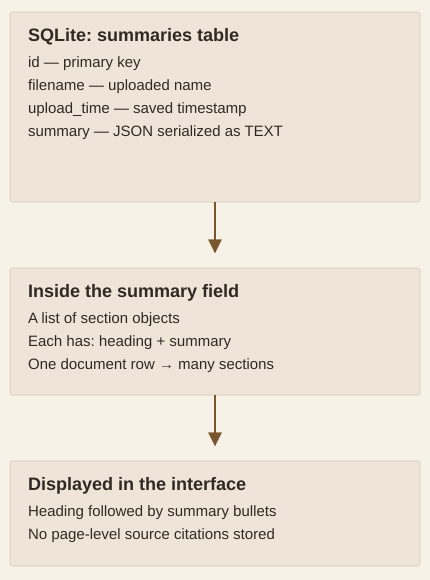

# How the application selects, summarizes, and stores sections

**Methods & limits · A source-based account of the 2025 implementation**

The application makes several decisions before a reviewer sees a digest. Understanding where text is transformed or excluded explains both the value of a focused summary and the risk of missing context.

## Recover headings, then flatten the document

The parser accepts `.pdf`, `.doc`, and `.docx` files. LlamaParse returns Markdown-like text, guided by instructions to preserve headings, narrative text, lists, and tables while removing document furniture such as titles and tables of contents.

The section-processing code initially treats every Markdown heading level alike. A language-model prompt then asks whether each candidate has a numeric or Roman-numeral scheme. Unconfirmed headings are demoted to body text. Retained headings define a **flat section list**, rather than a nested hierarchy of parent sections and subsections.

An unnumbered heading can therefore lose its role as a boundary without its text disappearing: it joins the surrounding body text. That can change the context used to assess relevance. The original slides recognize parser errors as a limitation, especially when their causes are difficult to correct.

An isolated check of the two local section-building functions confirmed the flattening and body-text behavior with an invented input and an explicit simulated heading verdict. No model was called; this check does not estimate heading-recognition accuracy.

[Parsing source](https://github.com/eliasbrown99/Capstone/blob/c8105f820f062c6097f1a0a2d39d11cdb0bffb4e/app/parser.py) · [Section-processing source](https://github.com/eliasbrown99/Capstone/blob/c8105f820f062c6097f1a0a2d39d11cdb0bffb4e/app/summarization.py)

## Select sections using a bounded excerpt

For each section, a prompt receives the heading, the **first 1,000 characters** of section text, and an organization-specific capability description. Only sections marked relevant continue to summarization. The 1,000-character limit concerns the selection excerpt, not the total amount of a selected section that can be summarized.

This design can exclude a section whose important requirements appear after its opening excerpt. The prompt also discourages some administrative and legal material; such exclusions should not be interpreted as evidence that those clauses have no business importance. The result is a selected digest, not a complete compliance review.

## Summarize chunks and request a short final list

Selected sections are split with a configured size of **2,000 characters** and **100 characters of overlap**. Each chunk is summarized. The partial summaries are concatenated and passed through another prompt requesting at most five bullets for that section.

These are character settings, not token counts or experimentally optimized values. The source configures `gpt-3.5-turbo` for heading refinement, relevance classification, and summarization. This describes the historical code; the report does not test the present availability or behavior of those service dependencies.

The final bullet limit is a prompt instruction. No deterministic post-generation validator enforces it. The saved snapshot does meet the top-level limit, with the nested-bullet qualification discussed on the [evidence page](EVIDENCE.md).

Model calls in one document's processing path

Heading candidates each receive a refinement call, dispatched concurrently. Every constructed section then receives a relevance call. Each retained section receives one call per nonempty text chunk and a final condensation call when partial summaries exist. The slides' “two-pass” description captures selection followed by summarization; it is not a count of all calls made by the implementation.

## Store a document row with embedded section records

The async SQLAlchemy layer stores one row in the `summaries` table per successful upload. The four fields are an ID, filename, upload timestamp, and a text field containing a JSON list. Each element of that list has a section heading and its summary.

<strong>How to read the diagram:</strong> follow the arrows from the database row into its JSON payload and then to the displayed result. The one-to-many relationship is inside the JSON; sections are not a separate relational table.

<figure class="analysis-figure diagram-figure narrow-diagram">

<figcaption><strong>What is saved—and available for review.</strong> The original schema retains the digest, but not source-page citations, original file contents, rejected sections, or model-run provenance. Source: database.py and main.py.</figcaption>
</figure>

The backend supports retrieval and text search across filenames and serialized summary content, plus deletion by record ID. The frontend presents saved summaries in tabs with upload dates. My teammates developed the backend and database; my role included frontend behavior and integration with those components.

## Separate interface intent from implementation guarantees

The interface makes processing and persistence visible, but two details qualify the presentation's feature description.

**Progress is a stage indicator.** The UI animates toward fixed percentages for upload, parsing, identification, summarization, and storage. In the backend, identification and summarization events are emitted consecutively before the combined processing function runs. Those percentages are not measured fractions of completed analysis or reliable estimates of time remaining.

**Duplicate replacement is incomplete in the reviewed source.** A filename-check endpoint and confirmation dialog exist. However, the frontend joins the default API base and `document-exists` path without a separating slash, and the upload endpoint inserts a new row rather than replacing an existing one. The report therefore does not describe reliable overwrite handling as a verified capability. The original implementation was preserved during this report work.

These findings come from source inspection and a local string-construction check. The application was not started, and no documents were sent to external services for this review.

[Backend source](https://github.com/eliasbrown99/Capstone/blob/c8105f820f062c6097f1a0a2d39d11cdb0bffb4e/app/main.py) · [Database source](https://github.com/eliasbrown99/Capstone/blob/c8105f820f062c6097f1a0a2d39d11cdb0bffb4e/app/database.py) · [Frontend source](https://github.com/eliasbrown99/Capstone/blob/c8105f820f062c6097f1a0a2d39d11cdb0bffb4e/solicitation-frontend/components/SolicitationDashboard.jsx)

## Evaluate each stage against its purpose

| Stage | Useful question | Evidence available here |
|---|---|---|
| Parsing and boundaries | Are headings, tables, and conditions retained in the right context? | Source plus qualitative presentation limitations |
| Relevance selection | Does it retain important requirements, including those late in a section? | Prompt and excerpt logic; no labeled recall estimate |
| Summarization | Are statements faithful and sufficiently complete? | Saved summary structure and length; no independent quality scores |
| Saved-result review | Can a person retrieve and verify the digest? | Implemented search/retrieval and historical UI screenshots; no page-level citations |
| Practical use | Does review become faster without losing important information? | Team observations; no timed comparison |

[Return to the overview](../README.md) · [Review the saved-output findings](EVIDENCE.md)
